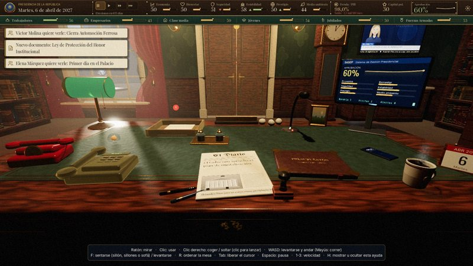
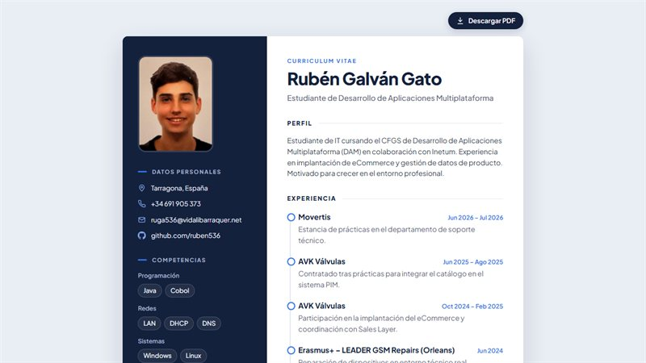

# ¡Hola, soy Rubén! 👋

### Estudiante de CFGS en Desarrollo de Aplicaciones Multiplataforma en colaboración con Inetum, con una base técnica en sistemas y redes. He participado en la implantación de un eCommerce y en la integración de catálogos de producto en un PIM, y estoy motivado para seguir creciendo en el entorno profesional. 🚀

---

#### Un poco sobre mí:

- 💻 **Actualmente cursando:** 2º de DAM en el Institut Vidal i Barraquer, en colaboración con Inetum.
- 🎓 **Formación previa:** CFGM en Sistemas Microinformáticos (2023–2025, Institut Vidal i Barraquer).
- 💼 **Experiencia:** soporte técnico en Movertis y eCommerce + catálogo PIM (Sales Layer) en AVK Válvulas, donde me contrataron tras las prácticas.
- ✈️ **Erasmus+:** reparación de dispositivos en LEADER GSM Repairs (Orleans, Francia).
- ⚙️ **Stack principal:** Java, COBOL, redes (LAN, DHCP, DNS) y sistemas Windows y Linux.
- 🌍 **Idiomas:** español y catalán nativos, inglés C1.
- 🎯 **Objetivo:** seguir creciendo como desarrollador y aportar valor desde el primer día.

---

#### Tecnologías y Herramientas:

  
  
  
  
  
  
  
  
  
  

---

#### Proyectos destacados:

<table>
  <tr>
    <td width="50%" valign="top">
      
      <h3>🎮 El Despacho</h3>
      
Simulador presidencial hecho en equipo con Godot 4. Despacho en 3D en primera persona, minijuegos dentro de la escena y arte, música y sonido generados por código.

      

        
        
        
      

      <a href="https://github.com/jorgeColom619/el-despacho"><b>Ver repositorio →</b></a>
    </td>
    <td width="50%" valign="top">
      
      <h3>📄 Curriculum Vitae</h3>
      
Mi currículum como página web en HTML y CSS: se adapta al móvil y se descarga en PDF con un clic.

      

        
        
        
      

      <a href="https://ruben536.github.io/CV/"><b>Ver online →</b></a> · <a href="https://github.com/ruben536/CV">Código</a>
    </td>
  </tr>
</table>

---

#### Contacto:

